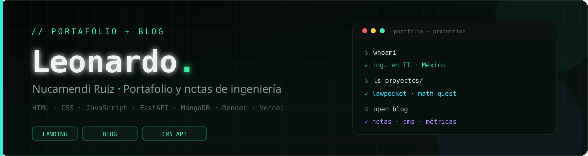

<div align="center">



<br>

<a href="https://mi-landing-devblog.vercel.app/">
  
</a>
<a href="https://mi-blog-dev.vercel.app/">
  
</a>
<a href="https://leonardo251207.github.io/mi-landing-devblog/">
  
</a>


# Portafolio DevBlog_

**Landing personal de Leonardo Nucamendi Ruiz.** Hero, tecnologías, proyectos,
certificaciones, últimas notas del blog y contacto.

[Demo en Vercel](https://mi-landing-devblog.vercel.app/) ·
[Blog](https://mi-blog-dev.vercel.app/) ·
[Repositorio del blog](https://github.com/Leonardo251207/mi-blog-dev)

</div>

---

## Dos repositorios, un ecosistema

| Repositorio | Contenido |
|---|---|
| **mi-landing-devblog** (este) | Portafolio: hero, tecnologías, proyectos, certificaciones, notas y contacto. |
| **[mi-blog-dev](https://github.com/Leonardo251207/mi-blog-dev)** | Blog, consola CMS, CMS API, métricas con GraphQL y generador estático. |

La landing enlaza al blog y el blog enlaza a la landing. Cada sitio se despliega
por separado, pero comparten el mismo CMS.

## Contenido editable desde el CMS

La landing **no está hardcodeada del todo**: su contenido se administra desde la
consola del blog.

- `landing.js` pide `GET /api/v1/sites/portfolio/landing` al CMS (con respaldo en
  `GET /api/v1/landing`) y aplica el contenido publicado, el tema del sitio y la
  publicidad activa (hero, secciones, proyectos, videos, certificaciones y contacto).
- La publicidad se carga desde el mismo endpoint y solo se muestra si está
  activa.
- Si el CMS no responde o el origen no está permitido por CORS, la página
  conserva el HTML estático y sigue siendo navegable.
- Las últimas notas también se piden al CMS (`GET /api/v1/posts`) y enlazan al
  blog.

Para editar el contenido:

1. Abre la consola: <https://mi-blog-dev.vercel.app/admin.html>.
2. Pestaña **Landing y publicidad**.
3. Guarda el borrador y pulsa **Publicar landing**.

## Secciones

| Sección | Contenido |
|---|---|
| **Hero** | Nombre, rol, propuesta, foto y CTA a proyectos/blog. |
| **Tecnologías** | C++, Java, JavaScript, Python, HTML y CSS. |
| **Proyectos** | Lawpocket, Math & English Quest y Marketplace Universitario. |
| **Publicidad** | Bloque opcional administrado desde el CMS. |
| **Certificaciones** | PDFs de Código Facilito, AWS Academy, Google y Cisco. |
| **Blog** | Últimas notas del CMS con enlace al blog completo. |
| **Contacto** | GitHub, LinkedIn y correo con copia al portapapeles. |

## Stack

`HTML5` · `CSS3` · `JavaScript vanilla` · `CMS API (FastAPI)` · `Vercel` ·
`GitHub Pages` · `GitHub Actions`

Sin frameworks ni build: son archivos estáticos que se sirven tal cual.

## Estructura

```text
mi-landing-devblog/
├── index.html            # Landing profesional editable
├── sitio.html            # Renderer multi-sitio para landings adicionales
├── styles.css            # Sistema visual retro-tech
├── sitio.css             # Estilos de videos y renderer multi-sitio
├── script.js             # Menú, scroll reveal y copia del correo
├── landing.js            # Aplica contenido y publicidad del portafolio
├── sitio.js              # Carga un sitio por ?site=slug
├── notes.js              # Últimas notas del blog
├── api.js                # Cliente de la API del CMS
├── api-config.js         # URLs y tokens públicos (local/producción)
├── metrics.js            # Beacon del colector de métricas
├── assets/               # Foto de perfil y certificados PDF
├── docs/banner.svg       # Banner del README
└── .github/workflows/    # Despliegue en GitHub Pages
```

## Multi-sitio y video

El mismo repo sirve landings adicionales con `sitio.html?site={slug}`:

- **Portafolio:** `/` (landing profesional).
- **Landing del proyecto:** `/sitio.html?site=devblog-project`.
- **Sitio del blog:** `mi-blog-dev.vercel.app` (hero controlado por el CMS).
- **Clientes nuevos:** crea el sitio en **CMS → Sitios**; la landing base se
  genera y publica automáticamente. No se reconstruye el CMS ni el renderer.

Cada sitio aplica su propio tema (acento, fondo, superficie, texto y fuentes) y
puede incluir **videos** por URL o subiendo un archivo al CMS: MP4/WebM/MOV,
YouTube o Vimeo, con póster, subtítulos VTT y CTA. En producción los archivos
se guardan en MongoDB GridFS y se sirven desde `/api/v1/media/{id}` (25 MB por
archivo); para videos largos conviene YouTube/Vimeo o un CDN.

> Los dominios personalizados de clientes requieren agregar el origen exacto a
> `CMS_CORS_ORIGINS` y `CORS_ORIGINS` en Render.

## Ejecutar en local

No necesita instalación. Desde la raíz del repo:

```powershell
python -m http.server 5599
```

Abre <http://127.0.0.1:5599/>.

Para ver el contenido dinámico y la publicidad, levanta también el CMS del repo
[`mi-blog-dev`](https://github.com/Leonardo251207/mi-blog-dev) en
`127.0.0.1:8080` y el colector de métricas en `127.0.0.1:8000`.

> Si los servicios locales no están corriendo, la landing usa su HTML estático y
> no registra métricas.

## Despliegue

### Vercel

1. Importa este repositorio en Vercel.
2. Framework preset: **Other**.
3. Build command: vacío. Output directory: `.`
4. Deploy.

### GitHub Pages

El workflow [`.github/workflows/static.yml`](.github/workflows/static.yml)
publica la raíz del repositorio en cada push a `main`. Solo hay que activar
**Settings → Pages → Source: GitHub Actions**.

### CORS del CMS

El CMS debe permitir el origen de la landing. En
`devblog-cms-leonardo → Environment → CMS_CORS_ORIGINS` agrega:

```text
https://mi-landing-devblog.vercel.app
```

`https://leonardo251207.github.io` ya está permitido para GitHub Pages.

## Mantenimiento

- El HTML de `index.html` es el respaldo estático y la plantilla que `landing.js`
  actualiza.
- Los colores y tipografías se controlan con variables CSS en `:root`.
- Si cambia la URL del blog, actualízala en `index.html`, `api-config.js`
  (`BLOG_BASE_URL`) y este README.
- La landing envía pageviews al mismo sitio `devblog` del colector, así que el
  tráfico de ambos repos aparece junto en GraphQL.

## Autor

**Leonardo Nucamendi Ruiz**  
Estudiante de Ing. en Tecnologías de la Información e Innovación Digital · México

[GitHub](https://github.com/Leonardo251207) ·
[LinkedIn](https://www.linkedin.com/in/leonardo-nucamendi-703b48441/) ·
[Blog](https://mi-blog-dev.vercel.app/)

---

<div align="center">
  <sub>Hecho con intención · 2026</sub>
</div>
